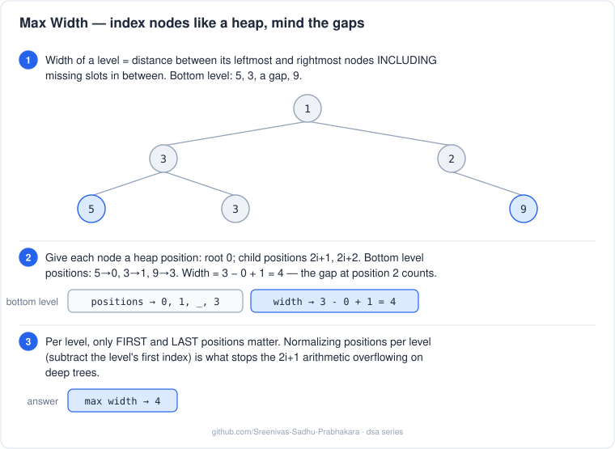

# Maximum Width of a Binary Tree

> Striver SDE Sheet 115 · Day 17 Binary Tree — give every node its heap index (2i, 2i+1), and a level's width is last minus first plus one; re-base per level to dodge overflow. Go, stdlib only, tested.

## Problem

The width of a level counts the slots from its leftmost to its rightmost node *including the null gaps between them* — as if the tree were drawn complete. Find the maximum width over all levels.

## Approach

Counting nodes per level isn't enough because of the gaps; what's needed is each node's *position*. Assign heap-style indexes — node i's children at 2i and 2i+1 — carried through a BFS; then a level's width is simply `lastIdx − firstIdx + 1`, gaps included, no placeholders enqueued. The classic hidden bug: on a deep skewed tree those indexes double per level and overflow. Since only differences within one level matter, re-basing each level's indexes to start at zero (`idx − base`) removes the overflow without changing any width.

**Complexity:** O(n) time, O(max level size) space.

## Visual walkthrough

Read the picture top to bottom — each numbered frame is one moment of the algorithm
running on this repo's test example.

## Run

    go test ./...   # verify
    go run .        # demo

---

One of 191 repos solving Striver's SDE Sheet in Go — stdlib only, one problem per repo, every solution tested. Browse the set: [`dsa-*` repos](https://github.com/Sreenivas-Sadhu-Prabhakara?tab=repositories&q=dsa-&type=source).
